<p align="center"></p>

<h1 align="center">VitaIRC for Android</h1>

<p align="center">
The IRC client from <a href="https://github.com/ArchelKrozt/VitaIRC">VitaIRC for PS Vita</a>, redesigned for touch screens.<br>
Several servers, bouncers with chat history, translation, image uploads, link previews and image search.
</p>

<p align="center"><b>English</b> · <a href="README.es.md">Español</a></p>

<p align="center">
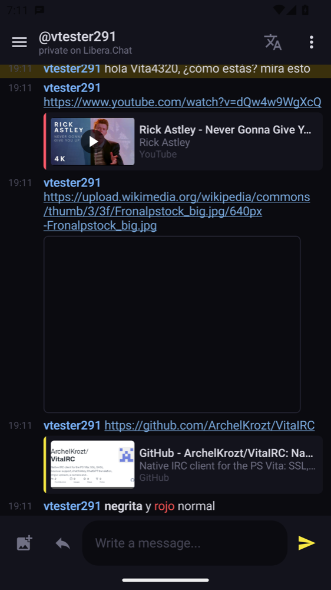
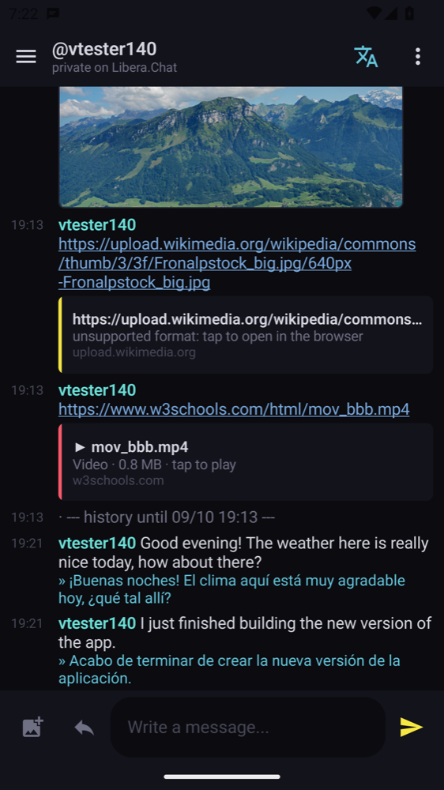
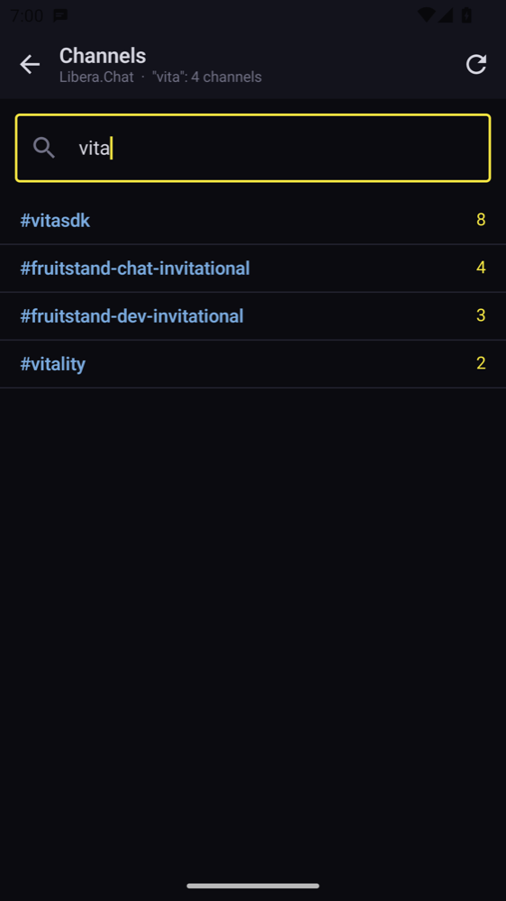
</p>

## Download

Get **`VitaIRC.apk`** from the [latest release](../../releases/latest), open it on the phone and allow
installing apps from your browser or file manager when Android asks. Android 8.0 or newer.

Updates install over the previous version and keep your servers, settings and history. The app checks
for new versions once a day (Settings → *Check for updates*).

## Features

**IRC**
- Several servers at once, SSL/TLS, SASL PLAIN, NickServ or server password, auto-join, nick recovery.
- Reconnects by itself (and checks the link when the network comes back); flood protection for
  private messages.
- **Stays connected in the background**, with notifications for private messages and mentions.
  Tapping one opens that conversation.
- Messages typed without connection are shown dimmed and sent after reconnecting.
- Commands: `/join /part /msg /query /me /nick /topic /whois /list /notice /away /back /ignore
  /op /deop /voice /devoice /kick /ban /kickban /quote /connect /disconnect /clear /help`.

**Bouncers (soju, ZNC)**
- IRCv3 `server-time`, `batch` and `chathistory`: what you missed arrives with its real time, private
  conversations included; older messages load when you scroll to the top.
- Reactions (`+draft/react`) and soju's `FILEHOST` uploads.

**Translation**
- Google (free, no account) or ChatGPT with your OpenAI API key.
- Incoming messages, your own messages before sending, or a single message; a language per channel.

**Images and links**
- Upload from the gallery or the camera to Litterbox (no account), ImgBB, Imgur or your soju server;
  the link goes into the message. Recent uploads keep their delete links.
- Link previews: image thumbnails, cards for pages and YouTube, a built-in video player.
- Image viewer with pinch zoom and double tap.
- Image search on Safebooru, Danbooru and Sankaku, with favorites, *send to chat* and *save to the
  gallery*. General content only unless adult content is enabled in Settings (18+).

**Made for touch**
- Window list in a side panel (fixed on the left on tablets and in landscape).
- Tap a message to reply, react, translate it, open a private chat, ignore or copy.
- Tap a nick in the user list for its options; operators get op, voice, kick and ban.
- Type `@` and the start of a nick to complete it; quick replies with recent nicks and messages.
- Channel browser with search on the whole server list, search inside a channel, jump to the last
  mention, mute a window, highlight words, mIRC colours, Spanish and English.

## Screenshots

| | | |
|---|---|---|
| 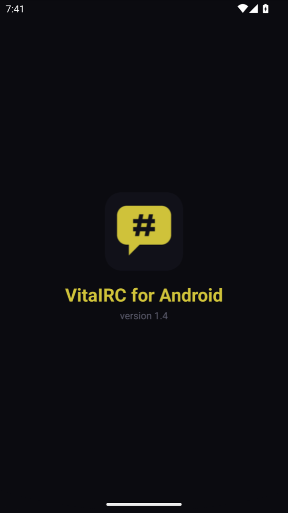 | 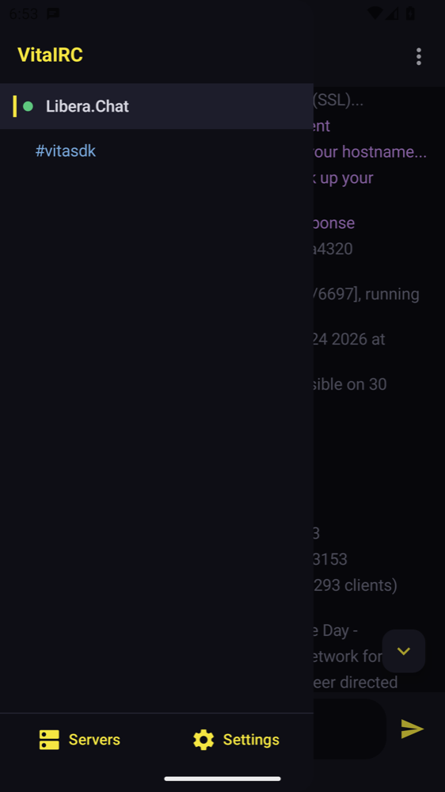 | 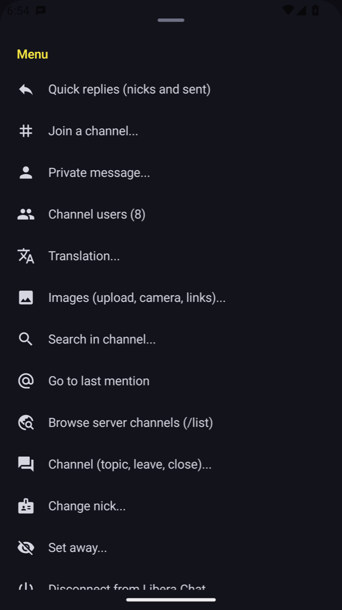 |
| 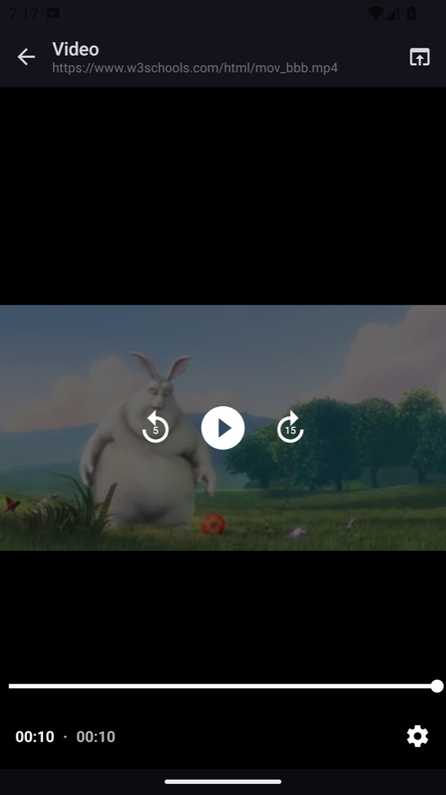 | 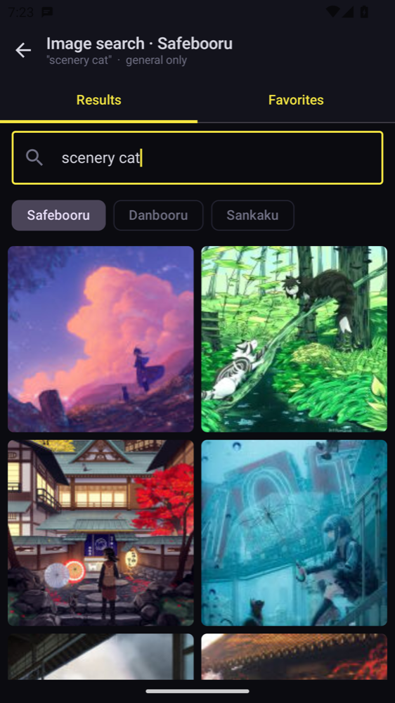 |  |
| 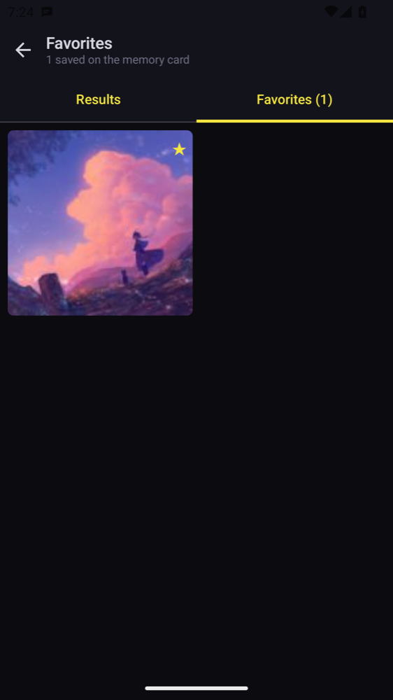 | 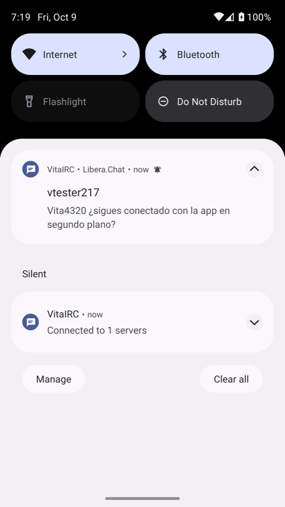 | 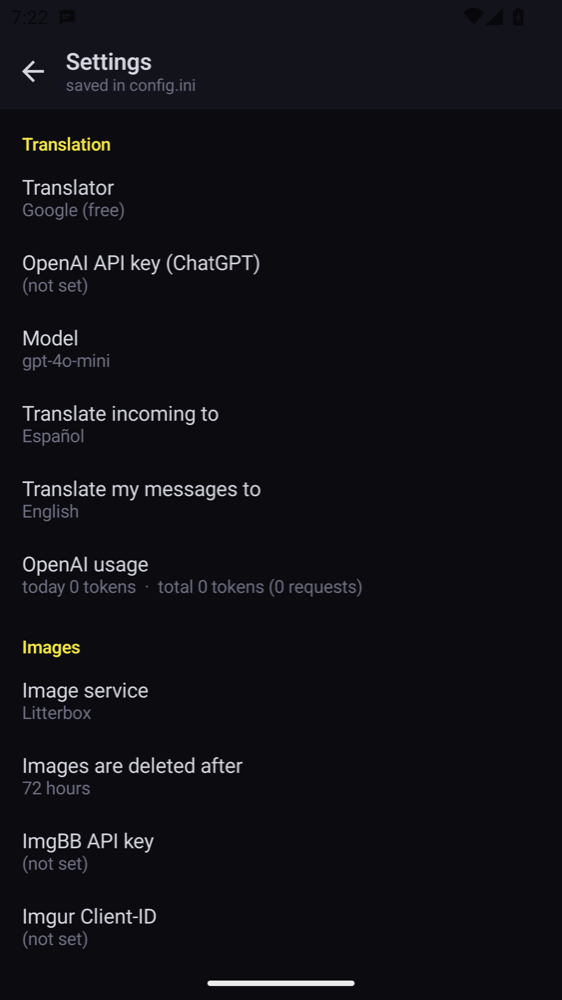 |

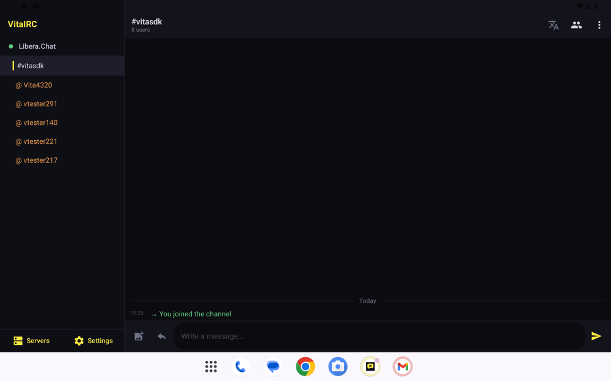

## Coming from the Vita

The settings file is the same as on the Vita: copy `ux0:data/VitaIRC/config.ini` and it works here too
(servers, translation and image settings). Chat logs use the same format.

## Building

Needs JDK 17 and the Android SDK (platform 34).

```sh
./build.sh                       # dist/VitaIRC.apk
./build.sh testReleaseUnitTest   # tests of the IRC core
python3 tools/gen_strings.py     # after adding texts: English table -> L.kt
```

Build output goes to `~/.vitairc-android-build`, outside the project.

### Signing

A release must always be signed with the same key, or Android refuses to install it over the
previous version. `build.sh` reads the key from `~/.android-keys/vitairc-android.properties`:

```
VITAIRC_KEYSTORE=/path/to/vitairc-android.jks
VITAIRC_KEYSTORE_PASSWORD=...
VITAIRC_KEY_ALIAS=vitairc
```

Without it the APK is signed with the debug key (fine for testing). The GitHub workflow tests and
builds every push. It publishes releases for tags (`v1.1`...) only when the repository has the key as
secrets (`KEYSTORE_BASE64`, the `.jks` in base64, and `KEYSTORE_PASSWORD`); otherwise releases are
made by hand with an APK built by `build.sh`.

The app finds new releases on its own: it downloads the release's `.apk` and opens Android's
installer, so every release needs the APK attached and a higher version (`versionName` in
`app/build.gradle.kts` and the tag).

## Code

| Path | What |
|---|---|
| `irc/Irc.kt` | IRC protocol, windows, chat-history merge, offline queue |
| `irc/Conn.kt` | TCP/TLS connection |
| `irc/Text.kt` | mIRC formatting, links, time |
| `data/` | `config.ini`, logs and open windows (same formats as the Vita) |
| `net/` | HTTP, translation, uploads, image search, link previews, updates |
| `ui/` | Jetpack Compose screens |
| `IrcService.kt`, `Notifier.kt` | Background connection and notifications |
| `tools/` | English texts: `strings_vita.py` (shared with the Vita) and `strings_android.py` |

## License

[MIT](LICENSE). Image search uses the public APIs of Safebooru, Danbooru and Sankaku; content
belongs to its authors.
